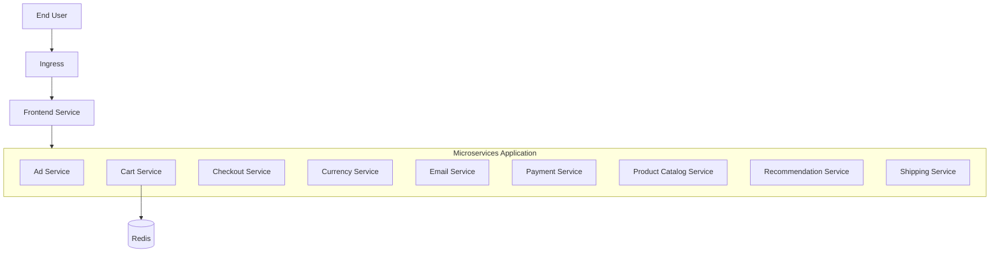
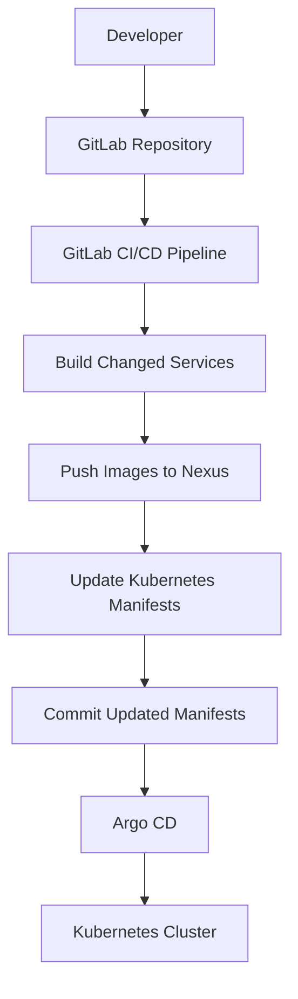
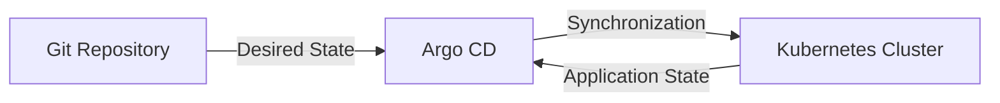

# Microservices Demo – Kubernetes & GitOps

A cloud-native microservices application demonstrating container orchestration, automated CI/CD workflows, private container registry integration, and GitOps-based Kubernetes deployments.


---

## Overview

This project demonstrates how a multi-service application can be containerized, deployed, and managed using Kubernetes and modern DevOps practices.

The application consists of independently deployable microservices that communicate to provide an integrated application experience.

The infrastructure and deployment workflow focuses on:

- Microservices architecture.
- Docker-based application packaging.
- Kubernetes workload orchestration.
- GitLab CI/CD automation.
- Container image management through Nexus Registry.
- GitOps-based deployment management using Argo CD.
- Declarative Kubernetes configuration.

## Architecture

The project separates application services, infrastructure components, and deployment automation.

### High-Level Architecture



The diagram represents the logical application architecture. Individual service communication paths should be understood alongside the application source and service definitions.

## Microservices

The application contains the following services:

| Service | Responsibility |
|---|---|
| Frontend | Provides the user-facing application |
| Ad Service | Handles advertisement-related functionality |
| Cart Service | Manages shopping cart operations |
| Checkout Service | Coordinates the checkout process |
| Currency Service | Provides currency conversion |
| Email Service | Handles email-related operations |
| Payment Service | Processes payment-related operations |
| Product Catalog Service | Manages product catalog information |
| Recommendation Service | Provides product recommendations |
| Shipping Service | Handles shipping-related functionality |
| Load Generator | Generates application traffic for testing |

Each service is maintained as an independent application component and can be packaged and deployed separately.

## Technology Stack

| Technology | Purpose |
|---|---|
| Docker | Container image creation |
| Kubernetes | Container orchestration |
| GitLab CI/CD | Build and deployment automation |
| Nexus Repository | Container image storage |
| Argo CD | GitOps-based deployment synchronization |
| Redis | Application caching and cart-related data |
| gRPC | Inter-service communication |
| YAML | Declarative infrastructure configuration |

## Repository Structure

The repository is organized into application source code, Kubernetes resources, CI/CD configuration, and GitOps deployment definitions.

```text
.
├── argocd/
│   ├── applications/
│   └── project.yaml
│
├── k8s/
│   ├── namespace/
│   ├── redis/
│   └── <microservice-manifests>/
│
├── protos/
│   └── demo.proto
│
├── src/
│   ├── adservice/
│   ├── cartservice/
│   ├── checkoutservice/
│   ├── currencyservice/
│   ├── emailservice/
│   ├── frontend/
│   ├── loadgenerator/
│   ├── paymentservice/
│   ├── productcatalogservice/
│   ├── recommendationservice/
│   └── shippingservice/
│
├── .gitlab-ci.yml
└── README.md
```

*Note: This is a logical overview of the repository structure. Refer to the actual directories and configuration files for the complete implementation.*

## CI/CD Pipeline

GitLab CI/CD automates the build and image publishing workflow.

The pipeline is organized around three main stages:

1. Build
2. Push
3. Update Manifests

### Pipeline Architecture



### Pipeline Stages

| Stage | Responsibility |
|---|---|
| Build | Builds Docker images for changed microservices |
| Push | Publishes built images to Nexus Container Registry |
| Update Manifests | Updates Kubernetes image references using the corresponding commit-based image tag |

### Image Versioning

Container images are tagged using commit-related identifiers to improve traceability between application source changes and deployed versions.

This approach helps identify which source revision is associated with a deployed container image.

## GitOps Deployment with Argo CD

Argo CD manages the deployment synchronization between the Git repository and the Kubernetes cluster.

The deployment workflow follows a declarative GitOps model:

- Kubernetes deployment configuration is maintained in Git.
- CI/CD updates the image references in the manifests.
- Argo CD detects repository changes.
- Argo CD synchronizes the desired configuration with Kubernetes.
- Kubernetes maintains the declared application state.

### GitOps Workflow



## Kubernetes Deployment

Kubernetes manifests are maintained under the `k8s/` directory.

The resources define application workloads, networking, and supporting components.

Common Kubernetes resources used by this project include:

- Namespace
- Deployment
- Service
- Ingress
- Redis Deployment and Service

### Useful Commands

Check cluster nodes:

```bash
kubectl get nodes
```

List application namespaces:

```bash
kubectl get namespaces
```

Inspect Pods:

```bash
kubectl get pods -A
```

Inspect Deployments:

```bash
kubectl get deployments -A
```

Inspect Services:

```bash
kubectl get services -A
```

Inspect application logs:

```bash
kubectl logs <pod-name> -n <namespace>
```

## Configuration Management

Application and deployment configuration is maintained through repository configuration files and Kubernetes manifests.

Sensitive values such as passwords, tokens, and registry credentials should be managed outside publicly accessible source files.

Do not commit production credentials or private infrastructure secrets to this repository.

## Monitoring and Troubleshooting

Useful Kubernetes commands for troubleshooting:

```bash
kubectl get pods -A
kubectl get events -A --sort-by=.metadata.creationTimestamp
kubectl describe pod <pod-name> -n <namespace>
kubectl logs <pod-name> -n <namespace>
```

For a specific Deployment:

```bash
kubectl describe deployment <deployment-name> -n <namespace>
```

## DevOps Concepts Demonstrated

This project demonstrates practical experience with:

- Microservices deployment.
- Container image creation and versioning.
- Kubernetes workload management.
- Automated CI/CD pipelines.
- Private container registry integration.
- Declarative infrastructure management.
- GitOps deployment workflows.
- Application release traceability.

## Future Improvements

Potential areas for further development:

- Prometheus and Grafana monitoring.
- Centralized logging.
- Distributed tracing.
- Automated container vulnerability scanning.
- Kubernetes resource requests and limits.
- Horizontal Pod Autoscaling.
- Helm-based application packaging.
- Automated deployment verification.

## Author

**Mahbod Rahimian**

DevOps Engineer

Areas of focus: Kubernetes, Docker, CI/CD, GitOps, Linux Infrastructure and Automation.
