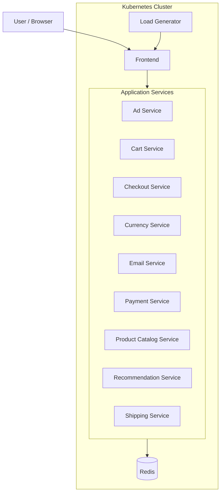
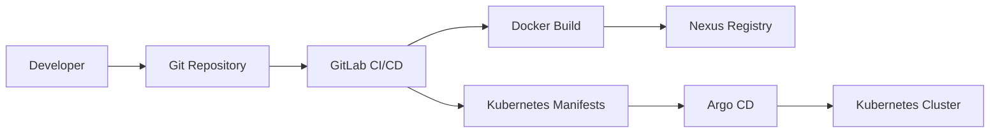
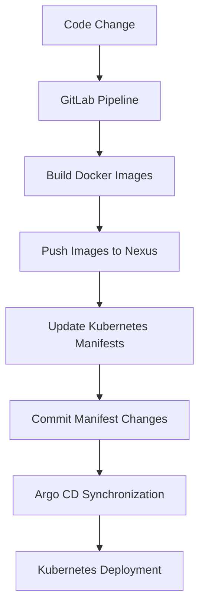

# Microservices Demo on Kubernetes

[](https://kubernetes.io/)
[](https://www.docker.com/)
[](https://docs.gitlab.com/ee/ci/)
[](https://argo-cd.readthedocs.io/)
[](https://grpc.io/)

A cloud-native microservices application deployed on Kubernetes, with an automated CI/CD workflow using GitLab CI, Nexus Container Registry, and Argo CD GitOps.

This repository demonstrates containerization, Kubernetes deployment, automated image delivery, and GitOps-based application lifecycle management.

---

## Table of Contents

- [Overview](#overview)
- [Architecture](#architecture)
- [Microservices](#microservices)
- [Technology Stack](#technology-stack)
- [Repository Structure](#repository-structure)
- [CI/CD Pipeline](#cicd-pipeline)
- [Deployment Lifecycle](#deployment-lifecycle)
- [GitOps with Argo CD](#gitops-with-argo-cd)
- [Kubernetes Deployment](#kubernetes-deployment)
- [Documentation](#documentation)
- [Upstream Project and Customizations](#upstream-project-and-customizations)
- [Security Considerations](#security-considerations)
- [Future Improvements](#future-improvements)
- [Author](#author)

---

## Overview

This project demonstrates how a distributed microservices application can be containerized and deployed on Kubernetes using modern DevOps practices.

The application consists of multiple independent services that communicate through service-to-service APIs, including gRPC-based communication.

The deployment workflow is designed around three main components:

1. **GitLab CI/CD** – Automates application build and image delivery.
2. **Nexus Repository** – Stores and manages container images.
3. **Argo CD** – Synchronizes Kubernetes manifests from Git and applies the desired state to the cluster.

The main objective is to demonstrate an automated and maintainable deployment workflow based on CI/CD and GitOps principles.

## Architecture

The application follows a microservices architecture in which each service is deployed independently as a Kubernetes workload.

### Logical Architecture



*Note: This diagram provides a logical overview of the application components and is not intended to represent every internal service-to-service communication path.*

### DevOps Architecture



## Microservices

The application contains multiple services, each responsible for a specific business capability.

| Service | Responsibility |
|---|---|
| Frontend | User-facing web application |
| Ad Service | Advertisement recommendations |
| Cart Service | Shopping cart management |
| Checkout Service | Checkout workflow |
| Currency Service | Currency conversion |
| Email Service | Email notifications |
| Payment Service | Payment processing |
| Product Catalog Service | Product information |
| Recommendation Service | Product recommendations |
| Shipping Service | Shipping cost and delivery operations |
| Load Generator | Generates application traffic for testing |

The services are deployed independently using Kubernetes manifests.

## Technology Stack

| Category | Technology |
|---|---|
| Application Architecture | Microservices |
| Programming Languages | Go, Java, C#, Python, Node.js |
| Containerization | Docker |
| Container Orchestration | Kubernetes |
| CI/CD | GitLab CI/CD |
| Container Registry | Nexus Repository |
| GitOps | Argo CD |
| Service Communication | gRPC |
| Application Data Store | Redis |
| Configuration | YAML |
| Version Control | Git |

## Repository Structure

```text
microservices-demo-kubernetes/
│
├── argocd/
│   ├── applications/
│   │   └── online-boutique.yaml
│   └── project.yaml
│
├── k8s/
│   ├── namespace/
│   ├── redis/
│   ├── adservice/
│   ├── cartservice/
│   ├── checkoutservice/
│   ├── currencyservice/
│   ├── emailservice/
│   ├── frontend/
│   ├── loadgenerator/
│   ├── paymentservice/
│   ├── productcatalogservice/
│   ├── recommendationservice/
│   └── shippingservice/
│
├── protos/
│
├── src/
│   ├── adservice/
│   ├── cartservice/
│   ├── checkoutservice/
│   ├── currencyservice/
│   ├── emailservice/
│   ├── frontend/
│   ├── loadgenerator/
│   ├── paymentservice/
│   ├── productcatalogservice/
│   ├── recommendationservice/
│   └── shippingservice/
│
├── docs/
│   ├── architecture.md
│   ├── ci-cd.md
│   └── gitops-deployment.md
│
├── .gitlab-ci.yml
└── README.md
```

*The structure above is a high-level representation. Actual filenames and directories should match the current repository contents.*

## CI/CD Pipeline

GitLab CI/CD is used to automate the application delivery process.

The pipeline is organized into three main stages:

### 1. Build

- Detects the services that need to be built.
- Builds Docker images for the relevant services.
- Uses commit-based image tags to identify each build.

### 2. Push

- Authenticates with the Nexus Container Registry.
- Pushes the generated Docker images to the private registry.
- Makes the images available for Kubernetes deployments.

### 3. Update Manifests

- Updates the image references in Kubernetes Deployment manifests.
- Uses the corresponding image tag generated by the pipeline.
- Commits the manifest changes to the Git repository.

### Pipeline Overview



## Deployment Lifecycle

The deployment lifecycle follows a GitOps-oriented workflow.

1. A developer pushes application changes to the Git repository.
2. GitLab CI/CD executes the pipeline.
3. Docker images are built for the relevant services.
4. Images are pushed to the Nexus Container Registry.
5. Kubernetes manifests are updated with the new image tags.
6. The updated manifests are committed to Git.
7. Argo CD detects the repository changes.
8. Argo CD synchronizes the desired state with the Kubernetes cluster.

This workflow separates application image delivery from Kubernetes deployment synchronization.

## GitOps with Argo CD

Argo CD is responsible for continuously monitoring the configured Git repository and synchronizing Kubernetes resources.

The desired application state is maintained in Git, allowing deployment changes to be tracked and reviewed through version control.

### Main Benefits

- Declarative Kubernetes configuration.
- Git-based deployment history.
- Automated synchronization.
- Easier rollback through Git history.
- Clear separation between CI and CD responsibilities.
- Improved deployment consistency.

Argo CD application configuration is maintained under:

```text
argocd/
├── applications/
│   └── online-boutique.yaml
└── project.yaml
```

## Kubernetes Deployment

The application is deployed using Kubernetes manifests.

The manifests define resources such as:

- Namespace
- Deployments
- Services
- Ingress
- Configurations and application resources

### Example Kubernetes Commands

Check cluster nodes:

```bash
kubectl get nodes
```

List application pods:

```bash
kubectl get pods -n <namespace>
```

List services:

```bash
kubectl get services -n <namespace>
```

List deployments:

```bash
kubectl get deployments -n <namespace>
```

Inspect a deployment:

```bash
kubectl describe deployment <deployment-name> -n <namespace>
```

View pod logs:

```bash
kubectl logs <pod-name> -n <namespace>
```

*Replace `<namespace>`, `<deployment-name>`, and `<pod-name>` with the actual values used in your cluster.*

## Documentation

Additional technical documentation is available in the `docs/` directory.

| Document | Description |
|---|---|
| [Architecture](docs/architecture.md) | Application architecture and main components |
| [CI/CD Pipeline](docs/ci-cd.md) | Build, image publishing, and manifest update workflow |
| [GitOps Deployment](docs/gitops-deployment.md) | Argo CD configuration and deployment synchronization |

## Upstream Project and Customizations

This project is based on the [Google Cloud Online Boutique microservices demo](https://github.com/GoogleCloudPlatform/microservices-demo).

The upstream project provides the sample microservices application and its core application components.

This repository focuses on DevOps and deployment-related implementation, including:

- Kubernetes deployment manifests.
- GitLab CI/CD workflow.
- Docker image build and delivery process.
- Nexus Container Registry integration.
- Kubernetes manifest image updates.
- Argo CD GitOps integration.

The upstream project's original license and attribution requirements must be preserved.

## Security Considerations

Security is an important part of operating containerized applications.

Recommended practices include:

- Avoid committing passwords, tokens, and credentials to Git.
- Use Kubernetes Secrets for sensitive configuration.
- Use private container registries for internal images.
- Apply least-privilege access to Kubernetes resources.
- Restrict access to CI/CD variables and deployment credentials.
- Regularly update container base images and application dependencies.

## Future Improvements

Potential areas for further development include:

- Implementing automated container image vulnerability scanning.
- Adding Prometheus and Grafana monitoring.
- Integrating centralized logging.
- Adding resource requests and limits for all workloads.
- Implementing Kubernetes NetworkPolicies.
- Adding automated security and quality checks to CI/CD.
- Improving deployment observability and rollback procedures.

## Author

**Mahbod Rahimian**

DevOps Engineer

GitHub: [MahbodRahimian](https://github.com/MahbodRahimian)
