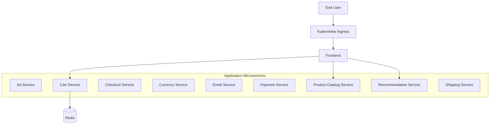
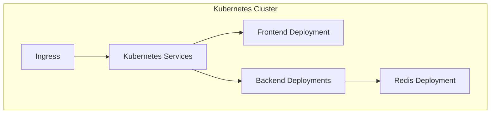

# Microservices Architecture

## 1. Overview

This document describes the logical architecture of the Microservices Demo application and its supporting infrastructure.

The application follows a microservices architecture in which business capabilities are implemented as independent services. Each service can be built, packaged, deployed, and maintained independently.

The project uses Kubernetes for workload orchestration and provides a foundation for automated application delivery.

## 2. Application Architecture

The application consists of multiple services responsible for different business capabilities.



This diagram provides a high-level view of the application. It is not intended to represent every inter-service communication path.

## 3. Microservice Responsibilities

| Service | Responsibility |
|---|---|
| Frontend | User-facing application interface |
| Ad Service | Advertisement-related functionality |
| Cart Service | Shopping cart management |
| Checkout Service | Checkout workflow coordination |
| Currency Service | Currency conversion |
| Email Service | Email-related operations |
| Payment Service | Payment processing functionality |
| Product Catalog Service | Product information and catalog |
| Recommendation Service | Product recommendation functionality |
| Shipping Service | Shipping-related operations |
| Load Generator | Generates traffic for application testing |

Each service has its own source directory under `src/`.

## 4. Service Communication

The application uses gRPC and Protocol Buffers for service communication.

The `protos/` directory contains protocol definitions used by the application.

Protocol definitions describe the service contracts and message structures exchanged between participating services.

## 5. Infrastructure Architecture

Kubernetes provides the runtime environment for the application.

The infrastructure configuration is maintained as declarative YAML manifests.



The actual service exposure and communication paths are defined by the Kubernetes manifests and application configuration.

## 6. Kubernetes Resources

| Resource | Purpose |
|---|---|
| Namespace | Logical isolation of application resources |
| Deployment | Manages application Pod replicas |
| Pod | Runs application containers |
| Service | Provides stable network access |
| Ingress | Manages external HTTP routing |
| ConfigMap | Stores non-sensitive configuration, where used |
| Secret | Stores sensitive configuration, where used |

## 7. Redis

Redis is included as a supporting infrastructure component.

It is deployed through dedicated Kubernetes manifests under:

```text
k8s/redis/
```

Redis provides supporting data storage functionality for the application, including shopping cart-related operations.

## 8. Design Principles

The project demonstrates the following architectural principles:

- Independent application services.
- Container-based application packaging.
- Declarative infrastructure configuration.
- Kubernetes-based workload orchestration.
- Service-oriented communication.
- Separation of application source code and deployment configuration.
- Automated application delivery through CI/CD and GitOps.

## 9. Related Documentation

- [CI/CD Pipeline](ci-cd.md)
- [GitOps Deployment](gitops-deployment.md)
- [Project README](../README.md)
