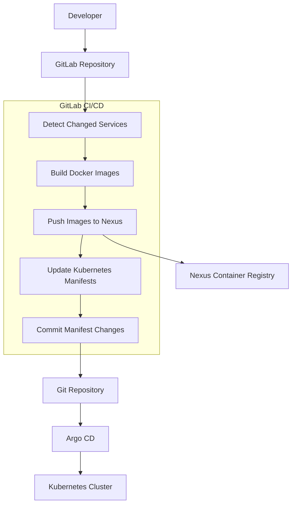

# CI/CD Pipeline

## 1. Overview

This project uses GitLab CI/CD to automate the build and image publishing workflow for its microservices.

The pipeline is designed to build only the services affected by source code changes, publish their container images to a private Nexus Container Registry, and update the Kubernetes deployment manifests.

The deployment configuration is maintained in Git and synchronized with the Kubernetes cluster through Argo CD.

## 2. Pipeline Architecture

## 3. Pipeline Stages

The pipeline is organized into three main stages.

### Stage 1: Build

The build stage prepares Docker images for changed microservices.

Main responsibilities:

- Identify services affected by source code changes.
- Build the corresponding Docker images.
- Apply a version tag associated with the source commit.

### Stage 2: Push

The push stage publishes the generated container images to the Nexus Container Registry.

Main responsibilities:

- Authenticate with the container registry.
- Push the generated images.
- Make the images available for Kubernetes deployments.

### Stage 3: Update Manifests

The final stage updates Kubernetes deployment manifests with the newly generated image references.

Main responsibilities:

- Update image tags in the relevant Kubernetes manifests.
- Use commit-related identifiers for image traceability.
- Commit the updated deployment configuration to Git.

## 4. Image Versioning

The workflow uses commit-related image tags.

This approach provides traceability between:

- Application source code.
- CI/CD pipeline execution.
- Container image versions.
- Kubernetes deployment configuration.

Using immutable or uniquely identifiable image tags helps avoid ambiguity when tracking deployed application versions.

## 5. Selective Service Builds

Building only changed services can reduce unnecessary CI/CD workload.

The intended workflow is:

1. Detect changed source directories.
2. Determine which microservices are affected.
3. Build the corresponding Docker images.
4. Publish only the required images.
5. Update the relevant deployment manifests.

The exact change-detection logic is implemented in the repository's CI/CD configuration.

## 6. Registry Integration

Nexus is used as the container image registry.

The pipeline publishes images to the configured registry, allowing Kubernetes workloads to retrieve the required application images.

Registry authentication credentials should be stored in protected CI/CD variables rather than committed to source control.

## 7. Pipeline Benefits

- Automated container image builds.
- Reduced unnecessary builds through change detection.
- Centralized image storage.
- Version traceability.
- Automated deployment manifest updates.
- Separation of application delivery and cluster synchronization.

## 8. Security Considerations

The following practices are recommended:

- Store registry credentials as protected CI/CD variables.
- Avoid hardcoding passwords and access tokens.
- Use unique image tags.
- Restrict access to deployment credentials.
- Scan container images for vulnerabilities.
- Protect production deployment branches.

## 9. Related Documentation

- [Application Architecture](architecture.md)
- [GitOps Deployment](gitops-deployment.md)
- [Project README](../README.md)
