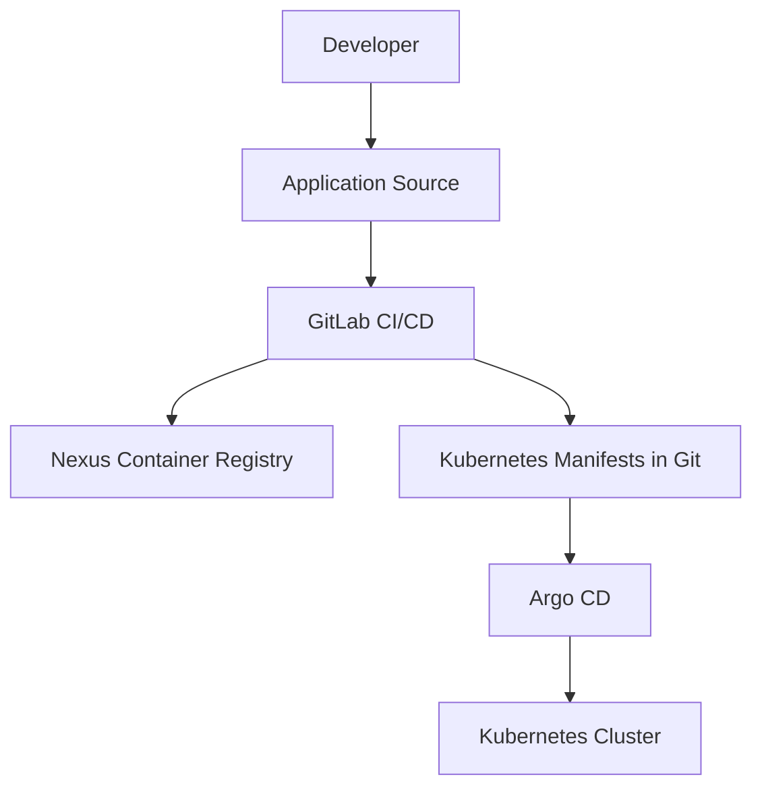

# GitOps Deployment with Argo CD

## 1. Overview

This project uses Argo CD to manage Kubernetes application deployments through a GitOps workflow.

The desired Kubernetes state is maintained in Git, while Argo CD continuously monitors the configured repository and synchronizes the cluster with the declared configuration.

This approach provides a declarative and version-controlled deployment process.

## 2. GitOps Architecture



## 3. Deployment Workflow

The deployment process follows these steps:

1. A developer changes application source code.
2. GitLab CI/CD detects the affected services.
3. Docker images are built.
4. Images are pushed to Nexus.
5. Kubernetes manifests are updated with the new image references.
6. The updated manifests are committed to Git.
7. Argo CD detects the repository changes.
8. Argo CD synchronizes the desired state with Kubernetes.

## 4. Argo CD Application Configuration

The repository contains Argo CD configuration under:

```text
argocd/
├── applications/
│   └── online-boutique.yaml
└── project.yaml
```

The application configuration defines the Git repository, target revision, Kubernetes destination, and deployment path.

The project configuration can be used to define Argo CD project-level access and resource restrictions.

Exact configuration values should be reviewed in the corresponding YAML files.

## 5. Desired State and Actual State

GitOps separates the desired state from the actual runtime state.

- Desired state: Kubernetes manifests stored in Git.
- Actual state: Resources currently running in Kubernetes.
- Argo CD: Monitors and reconciles differences between these states.


## 6. Operational Benefits

- Version-controlled infrastructure configuration.
- Declarative Kubernetes deployments.
- Deployment traceability.
- Consistent application synchronization.
- Easier rollback through Git history.
- Separation of CI image building and CD synchronization.

## 7. Useful Argo CD and Kubernetes Commands

Check Argo CD resources:

```bash
kubectl get applications -n argocd
```

Check application Pods:

```bash
kubectl get pods -A
```

Check deployment resources:

```bash
kubectl get deployments -A
```

Check Kubernetes events:

```bash
kubectl get events -A --sort-by=.metadata.creationTimestamp
```

The Argo CD namespace may differ between environments. Adjust the namespace in commands to match the actual installation.

## 8. Security Considerations

- Restrict access to Argo CD.
- Use appropriate repository credentials.
- Apply least-privilege permissions.
- Avoid storing credentials in Git.
- Review synchronization and pruning policies before enabling them in production.

## 9. Related Documentation

- [Application Architecture](architecture.md)
- [CI/CD Pipeline](ci-cd.md)
- [Project README](../README.md)
